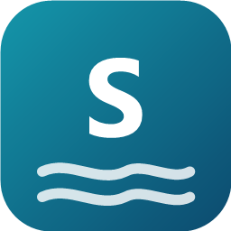

<p align="center">
  
</p>

<h1 align="center">Shorekeeper</h1>

<p align="center">
  <b>Peer-to-peer file sharing and messaging for the office LAN.</b><br>
  See who is online, drop files on them, chat — no server, no cloud, nothing leaves your network.
</p>

<p align="center">
  <a href="LICENSE"></a>
  
  
  
  
</p>

---

Every computer and phone running Shorekeeper finds the others on the network by itself. The **sender** picks who gets a file; the **recipient** sees it in their inbox and decides whether to download it. Files travel directly between the two devices at LAN speed, over mutually authenticated TLS. Devices that have not been trusted are **denied by default**.

## ✨ Features

### 📁 Files
- **Drag and drop** files or whole folders onto one or more people, from the main window, the **Quick Send** window (`Ctrl+Alt+S`), or Explorer's right-click menu.
- **The recipient decides**: download everything, pick some files, or skip.
- **Resumes** after a dropped connection; every file is checked with **SHA-256** before it is kept.
- **Withdraw** what you sent: whoever has not downloaded it yet no longer can.
- Files another program has open for writing are sent as a temporary copy.

### 💬 Messages
- One-to-one and **group conversations** with text, **voice messages**, and file cards (pictures preview in the chat).
- Delivered / seen receipts, withdraw within five minutes, delete for yourself.
- Group messages are **signed by their author** and passed on by other members, so whoever was offline still gets them, and newcomers see recent history.

### 👥 People and groups
- **Connect** two devices by comparing a 6-digit code, or by scanning the computer's **QR code** with the phone.
- **Groups**: anyone can ask to join, the creator approves; members can send to each other without connecting one by one.
- Works **across subnets** without a server: remembered addresses, contacts sharing who they see, group hosts, and an optional **Bridge** that lets every subnet see the others.

### 🔊 Sound
- **Play a computer's sound** on connected phones (and the other way round), or use the phone as a **microphone** for the computer, encrypted with AES-GCM, with an optional listening password.
- Control the computer's playback and volume from the listening phone.

### 📱 Android app
- Receives in the background with notifications ([Download] / [Skip] right from the notification).
- Send from any app through **Share**, or from the home screen **widget**.
- Optional **photo backup**: new pictures and videos go to a computer of your choice.

### 🏢 Built for the office
- **Per-machine MSI** installer that sets up the firewall rules, plus **Group Policy** templates (ADMX/ADML).
- Optional **Active Directory** integration: real names, departments and photos.
- **Identity backup**: move a device's identity to a new machine with a password-protected file.
- Interface in **English and Vietnamese**, light and dark themes.

## 🔒 Security and privacy

- Each device has its own key pair; its **DeviceId** is the SHA-256 of its public key. All connections are **mutual TLS**, and the peer is identified by its key, not its IP address.
- **Default deny**: a device you have not connected with may only say hello, ask to connect or ask to join a group. It cannot send you files or see your contacts.
- The device key is protected by **DPAPI** on Windows and the **Android Keystore** on phones.
- **No telemetry, no accounts, no cloud.** Shorekeeper only talks to other devices on your network. Usage statistics in Settings are counted and kept on your own device.

Ports used: UDP `47470` (discovery, multicast group `239.255.47.47`) and TCP `47471` (HTTPS peer API).

## 📦 Install

Download the MSI (Windows) or APK (Android) from the [Releases](https://github.com/dolehuy00/Shore/releases) page.

- **Windows 10/11 x64**: the MSI installs for all users and needs administrator rights. Releases are **not code-signed yet**, so SmartScreen may show *Unknown publisher*; choose *More info → Run anyway*.
- **Android 10+**: allow installing from your browser or file manager, then open the APK. On phones that stop background apps aggressively (OPPO, Xiaomi, Vivo…), allow Shorekeeper to run in the background to keep receiving with the screen off.

For company-wide deployment (silent install, GPO settings), see [docs/11-windows-deployment.md](docs/11-windows-deployment.md).

## 🛠️ Build from source

Requires the **.NET 10 SDK** (see `global.json`).

```bash
dotnet build Shorekeeper.sln
dotnet test --solution Shorekeeper.sln
dotnet run --project src/Shorekeeper.Desktop
```

- `-- --background` starts straight into the system tray; `-- --send <file>…` opens Quick Send with those files (this is what the Explorer menu calls).
- Engine tests run against `MiniHttpServer` by default; set `SHOREKEEPER_TEST_SERVER=kestrel` to run them against Kestrel.

<details>
<summary><b>Android, installers and releases</b></summary>

The Android app is not part of the solution and needs the `android` workload:

```bash
dotnet build src/Shorekeeper.Android -c Release
```

MSI installer (WiX v5) and signed release APK (the keystore and its password stay outside the repository, see [docs/14-android.md](docs/14-android.md) A6):

```bash
powershell -ExecutionPolicy Bypass -File deploy/build-msi.ps1
powershell -ExecutionPolicy Bypass -File deploy/build-apk.ps1
```

Linux and macOS builds compile but the interface has not been tried on real machines yet ([docs/02-architecture.md](docs/02-architecture.md) §9):

```bash
dotnet publish src/Shorekeeper.Desktop -c Release -r linux-x64 --self-contained
```

**Releasing:** raise `Version` in `Directory.Build.props`, then push a tag `v<Version>`. The `Release` workflow builds the MSI and APK and creates the GitHub Release.

</details>

## 🗂️ Project layout

| Project | Role |
|---|---|
| `src/Shorekeeper.Core` | Domain types, DeviceId, settings, platform interfaces. No network I/O, no Windows dependency |
| `src/Shorekeeper.Engine` | Identity, SQLite and migrations, discovery, peer API (`PeerApi` + `MiniHttpServer`), transfers, groups, chat, sound. No ASP.NET Core dependency |
| `src/Shorekeeper.Engine.Kestrel` | The peer API on Kestrel, for desktops |
| `src/Shorekeeper.Platform.Windows` | DPAPI, Group Policy, firewall, Mark of the Web, toasts, global hotkey, Active Directory |
| `src/Shorekeeper.Desktop` | Avalonia desktop app: main window, system tray, single instance |
| `src/Shorekeeper.Android` | Android app (Avalonia.Android) |
| `tests/*` | xUnit v3 |
| `deploy/msi`, `deploy/admx` | WiX installer, Group Policy templates |
| `deploy/build-apk.ps1`, `deploy/release-notes.md` | Signed APK, GitHub Release notes |

## 💾 Data on your computer

| Path | Contents |
|---|---|
| `%LOCALAPPDATA%\Shorekeeper\identity.pfx.dpapi` | Device key (DPAPI-encrypted) |
| `%LOCALAPPDATA%\Shorekeeper\shorekeeper.db` | Contacts, groups, transfers, messages (SQLite) |
| `%LOCALAPPDATA%\Shorekeeper\settings.json` | User settings |
| `%LOCALAPPDATA%\Shorekeeper\logs\` | Logs, kept for 14 days |

Deleting `identity.pfx.dpapi` gives the device a new DeviceId, and contacts must connect again. Before reinstalling Windows or changing computers, use **Settings → Back up identity…**, then **Restore…** on the new machine.

## 📚 Documentation

The design documents in [docs/](docs/README.md) cover the architecture, protocol, security model and roadmap. They are written in **Vietnamese**.

## 📄 License

[MIT](LICENSE) © 2026 Huy Đỗ
